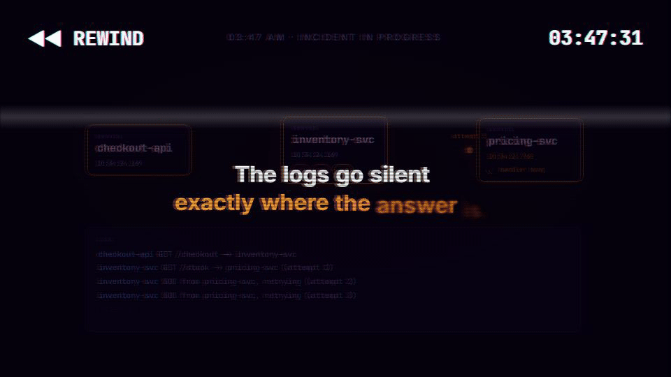
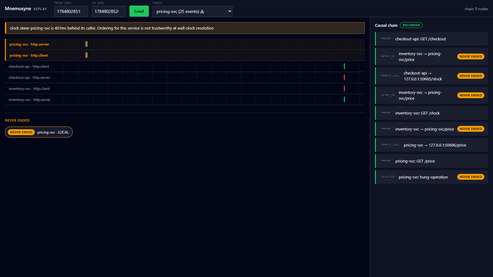
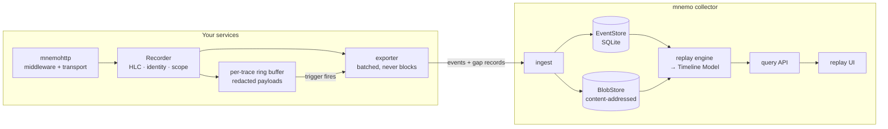

<div align="center">

# Mnemosyne

**A flight recorder for distributed systems.**

Record every request across your services with its full causal structure,<br>
then replay exactly what happened during the incident, including the parts that never finished.

[](https://github.com/JothishKamal/mnemosyne/actions/workflows/ci.yml)


<a href="docs/media/mnemosyne-demo.mp4">
  
</a>

**[▶ Watch the 74-second demo, with sound](docs/media/mnemosyne-demo.mp4)**

</div>

---

## The problem

It is 03:47. Checkout is timing out. Your logs show `inventory-svc` retrying `pricing-svc`, and then they stop.

The operation that matters most in an incident is usually the one that never finished: the hung RPC, the deadlocked query, the request killed mid-flight. Span-based tracing only records a span when it *ends*, so the timeline goes silent exactly where the answer is. Meanwhile the wall clocks on five machines disagree by hundreds of milliseconds, the payload that would explain everything was sampled away, and if the tracing pipeline dropped data, nothing tells you.

Mnemosyne is built around those failure modes.

> **Mnemosyne records execution, not interpretation.**
> Every event and every causal edge in a recording corresponds to something directly observed during execution. Explanations and root-cause analyses are layered on top of that immutable graph and never modify it.

## What it does

| | |
|---|---|
| **Events, not spans** | `BEGIN` is emitted the moment an operation starts; `END` carries the outcome. An operation that never ends is still on the record and renders as **never ended**. |
| **Causality is a DAG** | `PARENT` edges express scope within a process. `REMOTE_CALL` links a client to the server it called. `RETRY_OF` links attempt *N* to attempt *N−1*, so a retry storm is a traversal, not a guess. |
| **Hybrid logical clocks** | If A happened before B, then `hlc(A) < hlc(B)`, with no clock synchronization. Wall time is for display only, and a machine whose clock is provably skewed gets flagged in the UI instead of drawn as an impossible timeline. |
| **Retroactive capture** *(partly built)* | Payloads wait, redacted on the way in, in a bounded per-trace ring buffer, so that when a trigger fires the whole trace can flush, *including payloads from before anyone knew it mattered*. The ring buffer, redaction, and flush are in place; trigger evaluation and payload upload are not wired up yet. |
| **Backward trigger propagation** *(partly built)* | A triggered response carries `Mnemosyne-Capture: 1`, so every caller up the synchronous chain flushes too. Callers already honor the header; no server sets it yet. |
| **Loss that admits it** | The SDK never blocks your application and never grows unbounded; under pressure it drops. Every drop becomes a **gap record** (`N events dropped (UNREACHABLE)`), so a hole is never mistaken for silence. |
| **W3C compatible** | Propagates over standard `traceparent` plus one compact `tracestate` entry, so it coexists with existing tracing. |

## The replay UI

The collector serves a zero-dependency replay UI: swimlanes answer *when and how much*, and the linked causal-chain panel answers *what caused what*. This is the real UI showing the acceptance incident: `checkout-api → inventory-svc → pricing-svc`, where pricing hangs on the third retry and its clock runs 401 ms behind.

<p align="center">
  
</p>

## Quick start

You need Go 1.25+. Nothing else: the SQLite driver is pure Go, so `CGO_ENABLED=0` works.

```sh
# 1. Run the collector (ingest + query API + replay UI on one port)
go run ./cmd/mnemo                  # sqlite store in ./mnemo-data
go run ./cmd/mnemo -store memory    # or keep everything in memory

# 2. In another terminal, record the acceptance incident into it
go run ./cmd/mnemodev -scenario http://localhost:4318

# 3. Open the replay UI, click Load, then click the "never ended" operation
open http://localhost:4318
```

`mnemodev` has a couple of other modes for poking at the recorder by eye:

```sh
go run ./cmd/mnemodev -http-demo    # two instrumented services, every event printed as JSON
go run ./cmd/mnemodev -demo-event   # one fully populated event
```

## Instrument a service

```go
import (
	"github.com/jothishkamal/mnemosyne/sdk"
	"github.com/jothishkamal/mnemosyne/sdk/exporter"
	mnemohttp "github.com/jothishkamal/mnemosyne/sdk/instrument/nethttp"
)

ex := exporter.New(exporter.Config{Endpoint: "http://localhost:4318"})
defer ex.Close()

rec, err := sdk.New(sdk.Config{Service: "checkout-api", Sink: ex, Enabled: true})
if err != nil {
	log.Fatal(err)
}
ex.SetEmitterID(rec.EmitterID())

// Inbound: every request is recorded and joined to its caller's trace.
handler := mnemohttp.Middleware(rec)(mux)

// Outbound: calls carry traceparent + tracestate and are recorded as REMOTE_CALL edges.
// Pass the inbound request's context to outbound requests so they join the same trace.
client := &http.Client{Transport: mnemohttp.Transport(rec, nil)}
```

Custom operations use the same scope model: `h := rec.Begin(ctx, sdk.Local{Name: "reserve-stock"})`, do the work with `h.Context()`, then `h.End()`. Operations begun inside a scope are siblings under it, never accidentally parent and child.

## How it works



The replay engine joins `BEGIN`/`END` pairs by event ID (an unmatched `BEGIN` is in flight), orders by `(hlc, emitter_id)`, walks causal chains with a bounded BFS, and buckets lanes server-side, so **response size is a function of screen resolution, not incident size**.

### Collector API

| Endpoint | Returns |
|---|---|
| `POST /v1/batch` | Ingest a batch of events and gap records |
| `POST /v1/blobs/{blobID}` | Ingest a payload |
| `GET /api/timeline?from=&to=&resolution=` | Timeline Model: lanes, in-flight operations, gaps, skew warnings |
| `GET /api/chain?trace=&emitter=&seq=` | The recorded causal chain for one event |
| `GET /api/traces?from=&to=&service=&errors=1` | Trace search |
| `GET /api/blob/{blobID}` | A stored payload |
| `GET /healthz` | Liveness |

## Repository layout

```
schema/      protobuf recording format (the schema is the protocol) + golden conformance data
sdk/         core recorder: HLC, identity, scope context, capture engine, exporter
  instrument/nethttp/   package mnemohttp: server middleware and client transport
store/       EventStore + BlobStore interfaces; sqlite, blobfs, and memory backends; conformance suite
replay/      replay engine producing the Timeline Model
collector/   ingest, query, and the assembled HTTP API
ui/          embedded replay UI (no build step, no CDN, no web fonts)
harness/     deterministic incident harness: in-process services, virtual clocks, injectable faults
acceptance/  end-to-end definition of done for Spec 1
cmd/mnemo    the collector binary
cmd/mnemodev developer harness
docs/        design spec, implementation plan, and the demo video source
```

The dependency arrows are a hard rule: `sdk/` never imports an instrumented library. Integrations are thin adapters over the `Recorder`, which keeps the core small.

## Testing

```sh
make test     # go test ./...
make build
go vet ./...
```

The suite covers the claims above, not just the code paths:

- **Acceptance tests** (`acceptance/`): the incident from the demo, asserted end to end against durable storage. `REMOTE_CALL` edges span all three processes, the `RETRY_OF` attempts are siblings under one scope, the hung call is an unmatched `BEGIN`, ordering holds with one clock skewed by 400 ms, killing the collector yields gap records rather than silence, the chain reads as the incident narrative, and the recording survives a collector restart.
- **Property tests** (`pgregory.net/rapid`): HLC never violates happens-before under random interleavings, scope push and pop keep siblings as siblings, tracestate round-trips, and ring-buffer memory stays bounded.
- **Redaction tests**: denied keys are asserted absent from the output *bytes*, and redaction happens before anything enters the ring.
- **Store conformance suite** (`store/storetest`): every backend passes the same contract.
- **Schema goldens** (`schema/testdata`): the language-neutral fixtures future SDKs must reproduce.

CI runs build, tests, `-race`, `go vet`, and `gofmt` on every push.

## Status and roadmap

This repository is **Spec 1, the walking skeleton**: the recording schema, causal model, Go recorder, HTTP instrumentation, collector, and replay UI, proven end to end on one real cross-service incident. The full design is in [`docs/superpowers/specs/2026-07-23-mnemosyne-design.md`](docs/superpowers/specs/2026-07-23-mnemosyne-design.md).

| Version | Scope |
|---|---|
| **V1** | Go SDK, HTTP (done), then PostgreSQL, Redis, and Kafka adapters, and a richer UI and query surface |
| V2 | gRPC, OpenTelemetry bridge, goroutine tracking, hermetic single-service re-execution, collector-initiated retro-fetch |
| V3 to V5 | Node, Python, and JVM SDKs |

Still open in Spec 1: capture triggers (error, latency, explicit flag) are not evaluated yet, servers do not set the capture header, flushed payloads are not uploaded to the collector, and the HTTP adapter does not record bodies yet, so recordings over HTTP are currently metadata only. The payload path (`Handle.RecordRequest` / `RecordResponse`, content-addressed `PayloadRef`s, the blob store and its API) is built and tested underneath.

Known v1 limits, documented rather than papered over: backward trigger propagation is best-effort and does not cross asynchronous boundaries like Kafka; there is no authentication on ingest or query; recordings have no retention policy yet.

## About the demo video

The video is code. Its source lives in [`docs/demo`](docs/demo): the visuals are a [Remotion](https://www.remotion.dev) project, the replay footage is the real UI showing a real recording of the acceptance scenario, and the score is synthesized from scratch by [`docs/demo/music/score.py`](docs/demo/music/score.py) (oscillators and filtered noise only, no samples), arranged bar for bar against the scene timeline.

```sh
cd docs/demo
npm install
npm run music     # synthesize public/score.wav (needs numpy + scipy; required before rendering)
npm run studio    # live preview
npm run render    # docs/media/mnemosyne-demo.mp4
npm run gif       # docs/media/mnemosyne-teaser.gif
```

---

<div align="center">
<sub>Named for Mnemosyne, the Titan of memory and mother of the Muses.</sub>
</div>
